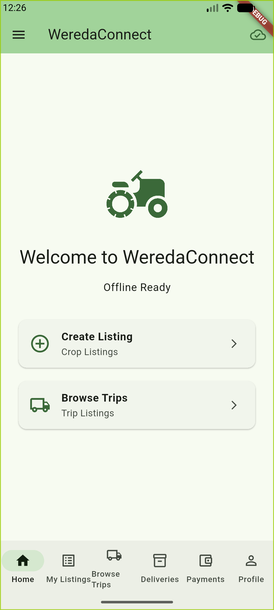
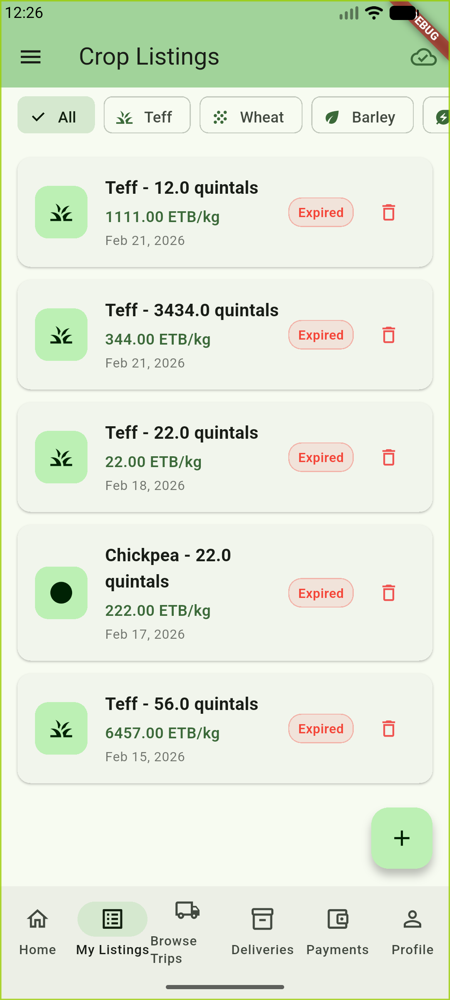
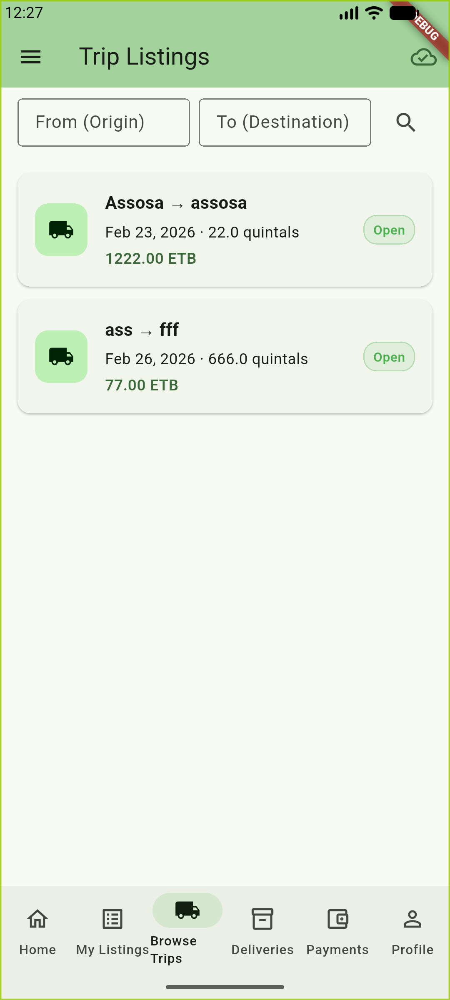
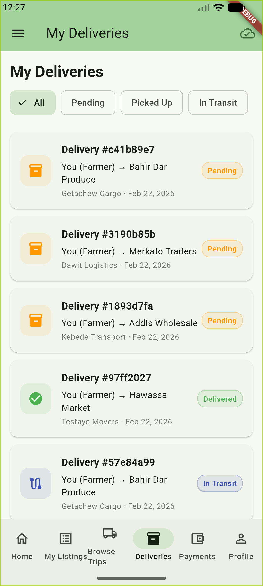
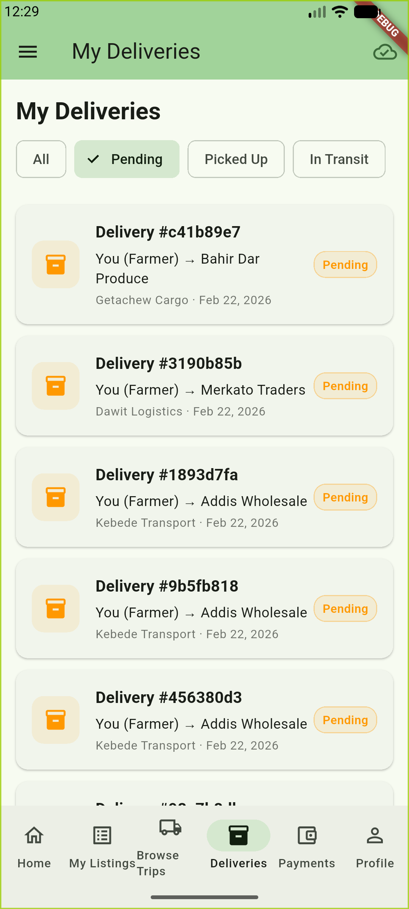
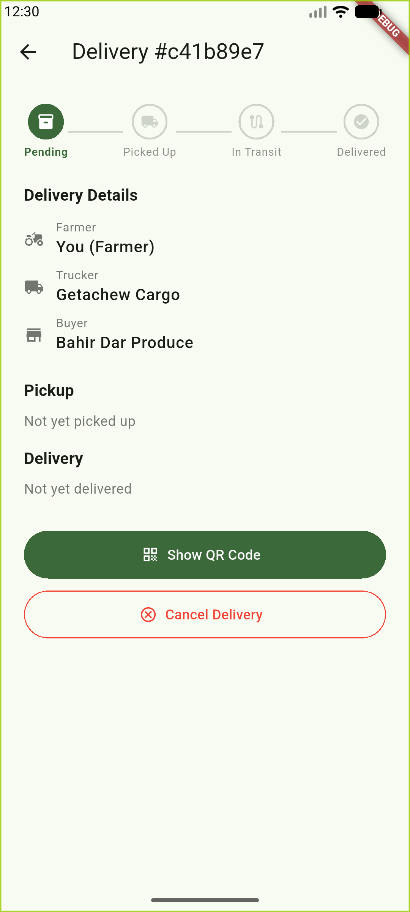
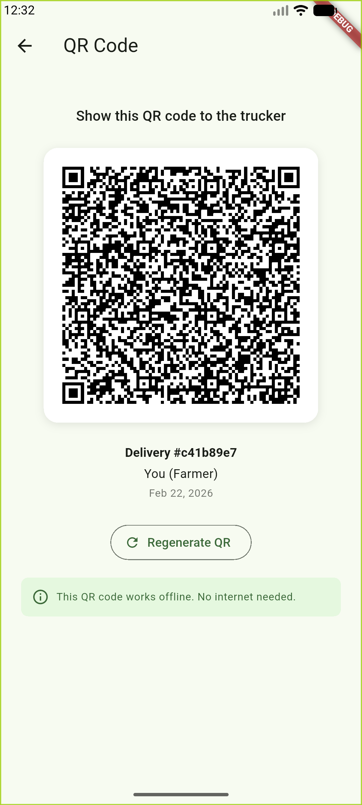
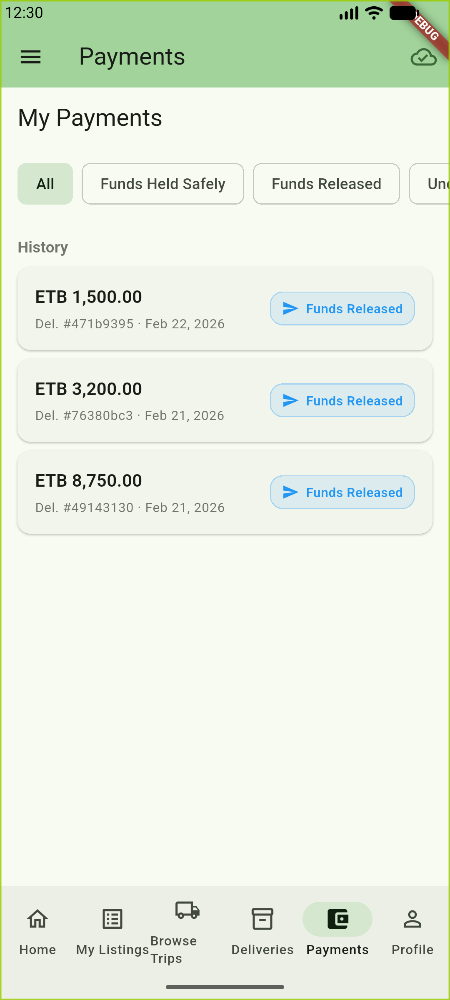
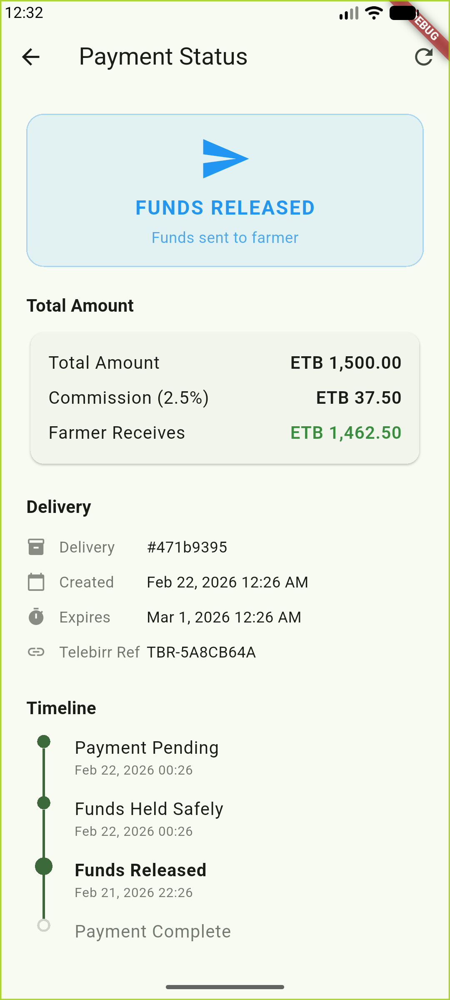
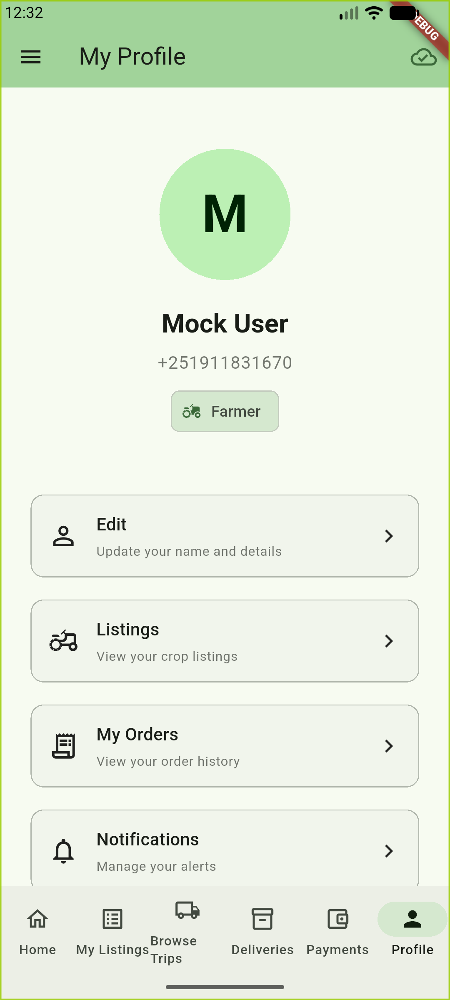

# WeredaConnect — Farmer Guide

> **WeredaConnect** is an offline-first agritech logistics platform connecting Ethiopian farmers, transport providers, and wholesale buyers. This guide walks through every screen of the application from the **Farmer's** perspective.

---

## 01 Home

**Purpose:** The Home screen serves as the central starting point for all farmer activity, providing quick access to core workflows.

**What the User Sees:**
On this screen, the farmer is greeted with the WeredaConnect brand identity and an "Offline Ready" indicator confirming that the application works without an internet connection. Two prominent action cards are displayed for the most common tasks: creating a crop listing and browsing available transport trips.

**Primary User Actions:**
1. Tap **Create Listing** to post a new crop listing to the marketplace.
2. Tap **Browse Trips** to find available transport routes and connect with truckers.
3. Use the bottom navigation bar to access any section of the application.

**Expected Outcome:**
The farmer quickly orients themselves and navigates to the task they need to perform, whether listing crops for sale or finding transport.

**Common Sales Talking Points:**
- The "Offline Ready" badge immediately communicates reliability in low-connectivity environments.
- Two-tap access to core workflows reduces the learning curve for first-time users.
- Bottom navigation provides persistent access to four sections (Home, Orders, Deliveries, Payments) plus a central button to list a crop.
- Clean, uncluttered design is optimized for users with limited smartphone experience.

---

## 02 My Listings (Crop Listings)

**Purpose:** The My Listings screen displays all crop listings the farmer has created, allowing them to manage their produce offerings in the marketplace.

**What the User Sees:**
On this screen, the farmer sees a filterable list of their crop listings. Filter chips at the top allow browsing by crop type (All, Teff, Wheat, Barley, and more). Each listing card shows the crop type, quantity in quintals, price per kilogram in Ethiopian Birr (ETB), the date posted, and the current status. A floating action button (+) in the bottom-right corner allows creating a new listing.

**Primary User Actions:**
1. Tap a **crop type filter chip** (e.g., Teff, Wheat) to narrow the list to a specific crop.
2. Tap a **listing card** to view or edit the listing details.
3. Tap the **delete icon** on any listing to remove it from the marketplace.
4. Tap the **+ button** to create a new crop listing.

**Expected Outcome:**
The farmer sees a clear overview of everything they have listed for sale, can filter by crop type, and can quickly add new listings or remove old ones.

**Common Sales Talking Points:**
- Supports multiple Ethiopian staple crops (Teff, Wheat, Barley, Chickpea, and more).
- Prices displayed in ETB per kilogram reflect local market conventions.
- Quantities in quintals match the standard agricultural measurement used across Ethiopia.
- Listings are stored locally and sync when connectivity is available.
- Status indicators (e.g., "Expired") help farmers manage their active offerings.

---

## 03 Browse Trips (Trip Listings)

**Purpose:** The Browse Trips screen allows the farmer to discover available transport routes offered by truckers, enabling them to match their produce with logistics capacity.

**What the User Sees:**
On this screen, the farmer sees a searchable list of available trips. Two search fields at the top allow filtering by origin and destination. Each trip card shows the route (origin to destination), the date, available cargo capacity in quintals, the trip status (e.g., "Open"), and the transport cost in ETB.

**Primary User Actions:**
1. Enter an **origin location** in the "From (Origin)" field to filter by pickup area.
2. Enter a **destination** in the "To (Destination)" field to filter by delivery location.
3. Tap the **search icon** to apply the location filters.
4. Tap a **trip card** to view full route details and request transport.

**Expected Outcome:**
The farmer finds a suitable transport route matching their origin, destination, and cargo requirements, and can proceed to book the trip.

**Common Sales Talking Points:**
- Location-based search helps farmers find truckers serving their specific rural area.
- Capacity displayed in quintals matches agricultural standards.
- Transparent pricing in ETB eliminates guesswork and price negotiation.
- Open status indicates the trip is accepting cargo, providing real-time availability.

---

## 04 My Deliveries (All Statuses)

**Purpose:** The My Deliveries screen provides a comprehensive overview of all the farmer's active and completed deliveries across all stages of the logistics process.

**What the User Sees:**
On this screen, the farmer sees a list of all their deliveries with status filter chips at the top (All, Pending, Picked Up, In Transit, Delivered, Disputed). Each delivery card displays a unique delivery reference number, the route (Farmer to Buyer), the assigned trucker, the date, and a color-coded status badge. Status icons on the left visually distinguish each delivery stage — orange for Pending, green for Delivered, and blue for In Transit.

**Primary User Actions:**
1. Tap a **status filter chip** to view only deliveries in a specific stage (e.g., Pending, In Transit).
2. Tap a **delivery card** to view full details, verify pickup/delivery, or manage the shipment.
3. **Pull down** to refresh the delivery list.

**Expected Outcome:**
The farmer gets an at-a-glance overview of all their shipments, can quickly find deliveries in a specific stage, and drill into any delivery for detailed actions.

**Common Sales Talking Points:**
- Color-coded status badges (orange for Pending, green for Delivered, blue for In Transit) enable instant visual recognition.
- Single filter row keeps the interface simple while covering the full delivery lifecycle.
- Each delivery shows all three participants (Farmer, Trucker, Buyer) for full supply chain transparency.
- Works entirely offline with local data, syncing updates when connectivity returns.

---

## 05 My Deliveries (Filtered by Pending)

**Purpose:** This view demonstrates the status filtering capability, showing only deliveries awaiting pickup.

**What the User Sees:**
On this screen, the "Pending" filter chip is selected (highlighted with a checkmark), and only deliveries with a "Pending" status are displayed. All delivery cards show the orange "Pending" badge, confirming the filter is working correctly.

**Primary User Actions:**
1. Review all deliveries that are waiting for trucker pickup.
2. Tap any **delivery card** to generate a QR code for the trucker to scan at pickup.
3. Tap **All** to return to the unfiltered view.

**Expected Outcome:**
The farmer sees only the deliveries that require their attention for the next step (generating a QR code for the trucker), reducing clutter from completed or in-progress shipments.

**Common Sales Talking Points:**
- Smart filtering lets users focus on actionable items rather than scrolling through all deliveries.
- Pending deliveries prompt the farmer to prepare for pickup by having their QR code ready.
- Filter state is preserved during the session for a seamless workflow.

---

## 06 Delivery Detail

**Purpose:** The Delivery Detail screen provides a complete view of a single delivery, including its current status, all participants, and available actions.

**What the User Sees:**
On this screen, the farmer sees a visual status timeline at the top showing the four stages of a delivery (Pending, Picked Up, In Transit, Delivered), with the current stage highlighted. Below the timeline, the Delivery Details section lists all three participants with their roles and names (Farmer, Trucker, Buyer). The Pickup and Delivery sections show the progress of physical goods movement. At the bottom, action buttons are available based on the delivery status.

**Primary User Actions:**
1. Tap **Show QR Code** to generate a verification QR code for the trucker to scan at pickup.
2. Tap **Cancel Delivery** to cancel this shipment (available only before goods are in transit).

**Expected Outcome:**
The farmer generates a QR code that the trucker will scan when picking up the goods, creating a verifiable record of the handoff.

**Common Sales Talking Points:**
- The four-step visual timeline gives all parties a shared understanding of where the delivery stands.
- QR-based verification creates a tamper-proof record of every handoff in the supply chain.
- Role-based actions ensure each participant can only perform actions appropriate to their role.
- Cancel option available early in the process provides flexibility while protecting all parties once goods are in transit.

---

## 07 QR Code Verification

**Purpose:** The QR Code screen generates a scannable verification code that the farmer shows to the trucker at the point of pickup, creating a secure handoff record.

**What the User Sees:**
On this screen, the farmer sees a large, scannable QR code with clear instructions: "Show this QR code to the trucker." Below the QR code, the delivery reference number, the user's role, and the date are displayed. A "Regenerate QR" button allows creating a fresh code if needed. An informational banner at the bottom confirms: "This QR code works offline. No internet needed."

**Primary User Actions:**
1. Present the **QR code** to the trucker for scanning.
2. Tap **Regenerate QR** if a new code is needed.
3. Tap the **back arrow** to return to the delivery detail.

**Expected Outcome:**
The trucker scans this QR code with their device, confirming they have received the goods from the farmer. The delivery status advances from "Pending" to "Picked Up."

**Common Sales Talking Points:**
- Offline QR verification is a key differentiator — no internet connection is required at the point of handoff.
- Eliminates disputes about whether goods were actually picked up by creating a digital proof of transfer.
- Simple "show and scan" interaction requires minimal training for both farmers and truckers.
- Regenerate option provides security: if a code is compromised, a new one can be issued instantly.

---

## 08 Payment History

**Purpose:** The Payment History screen provides a complete view of all the farmer's escrow payment transactions, with the ability to filter by status.

**What the User Sees:**
On this screen, the farmer sees status filter chips at the top (All, Funds Held Safely, Funds Released, Under Review, Refunded) and a "History" section listing all payment transactions. Each payment card shows the amount in ETB, the associated delivery reference number, the date, and a color-coded status badge. In this view, all three payments show "Funds Released," indicating the farmer has been paid for these deliveries.

**Primary User Actions:**
1. Tap a **status filter chip** to view only payments in a specific stage (e.g., Funds Released, Under Review).
2. Tap a **payment card** to view the full payment breakdown, timeline, and Telebirr reference.
3. **Pull down** to refresh the payment list.

**Expected Outcome:**
The farmer gets a clear financial overview of all their transactions, can filter to find specific payments, and can drill into any transaction for full details.

**Common Sales Talking Points:**
- Escrow-based payments protect both farmers and buyers — funds are held securely until delivery is confirmed.
- Transparent status labels (Funds Held Safely, Funds Released) use business language instead of technical terms.
- All amounts displayed in ETB with clear formatting for accessibility.
- Payment history provides an audit trail for financial record-keeping.

---

## 09 Payment Status (Escrow Detail)

**Purpose:** The Payment Status screen provides a comprehensive breakdown of a single escrow transaction, including the amount, commission, farmer payout, and a visual timeline of the payment lifecycle.

**What the User Sees:**
On this screen, the farmer sees a prominent status badge at the top ("FUNDS RELEASED — Funds sent to farmer"). The Total Amount section provides a detailed financial breakdown: the total payment amount, the platform commission (2.5%), and the net amount the farmer receives. The Delivery section shows the linked delivery reference, creation date, expiration date, and Telebirr mobile money reference. The Timeline section visually tracks the payment through its lifecycle stages (Payment Pending, Funds Held Safely, Funds Released, Payment Complete).

**Primary User Actions:**
1. Review the **amount breakdown** to confirm the total, commission, and payout.
2. Reference the **Telebirr Ref** for mobile money reconciliation.
3. Review the **timeline** to see the full payment history with timestamps.
4. Tap the **refresh icon** in the top-right to check for status updates.

**Expected Outcome:**
The farmer has full visibility into how much was paid, how much they receive after commission, and the exact status of the funds at every stage.

**Common Sales Talking Points:**
- Full financial transparency: farmers see exactly what they receive and what the platform commission is.
- Telebirr integration leverages Ethiopia's dominant mobile money platform, requiring no bank account.
- Commission structure (2.5%, minimum ETB 5) is clearly displayed, building trust with all parties.
- Visual timeline provides an auditable record of every state change with timestamps.
- Auto-expiry date (7 days) protects buyers from indefinitely locked funds.

---

## 10 Profile

**Purpose:** The Profile screen displays the farmer's account information, role, and provides access to account management features.

**What the User Sees:**
On this screen, the farmer sees their profile avatar, display name, phone number (Ethiopian format), and their registered role displayed as "Farmer." Below the profile information, action cards provide access to account management: Edit (update name and details), Listings (view crop listings), My Orders (view order history), and Notifications (manage alerts).

**Primary User Actions:**
1. Tap **Edit** to update personal information.
2. Tap **Listings** to view and manage crop listings.
3. Tap **My Orders** to review order history.
4. Tap **Notifications** to configure alert preferences.

**Expected Outcome:**
The farmer can manage their account settings, review their activity, and configure notifications from a single, organized screen.

**Common Sales Talking Points:**
- Role-based identity ("Farmer") determines what features and actions are available throughout the app.
- Phone number displayed in Ethiopian format (+251) reflects local mobile conventions.
- Centralized profile management reduces complexity for users managing multiple activities.
- Notification management allows users to stay informed without being overwhelmed, important for users with limited data plans.

---

## Navigation Overview

WeredaConnect uses a persistent bottom navigation bar with four sections and a central action button:

| Tab | Purpose |
|-----|---------|
| **Home** | Dashboard with quick actions and your crop listings |
| **Orders** | Orders buyers have placed for your crops |
| **Deliveries** | Track shipments and verify handoffs |
| **Payments** | View escrow payment history |
| **(+) Sell Crops** | Center floating button — create a new crop listing |

---

## Farmer Journey Summary

The typical farmer workflow in WeredaConnect follows these steps:

1. **List crops** — Create a listing with crop type, quantity (quintals), and price (ETB/kg).
2. **Find transport** — Browse available trips and match with a trucker heading to the buyer's location.
3. **Verify pickup** — Show QR code to the trucker when they arrive to collect the goods.
4. **Track delivery** — Monitor the shipment as it moves from farm to buyer.
5. **Receive payment** — After the buyer confirms delivery, funds are released from escrow to the farmer's Telebirr account.

This end-to-end flow operates offline, ensuring farmers in rural areas with limited connectivity can participate fully in the marketplace.

---

*This documentation was generated from sample data for sales and training purposes. Actual user data, crop types, and transaction amounts will vary based on real marketplace activity.*
