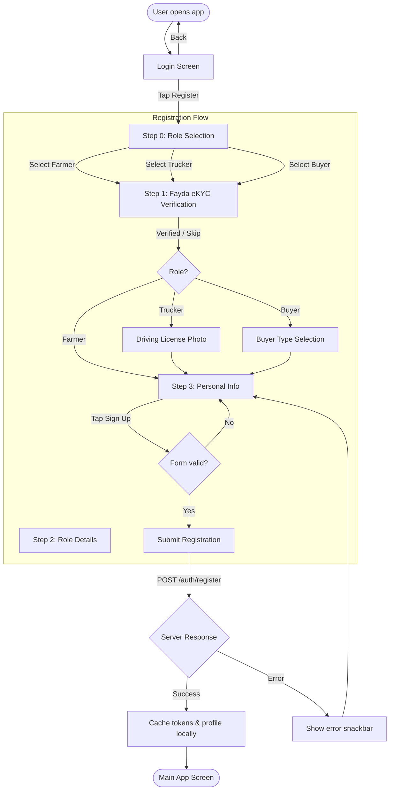
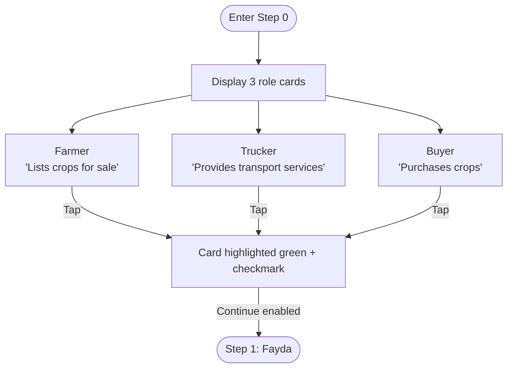
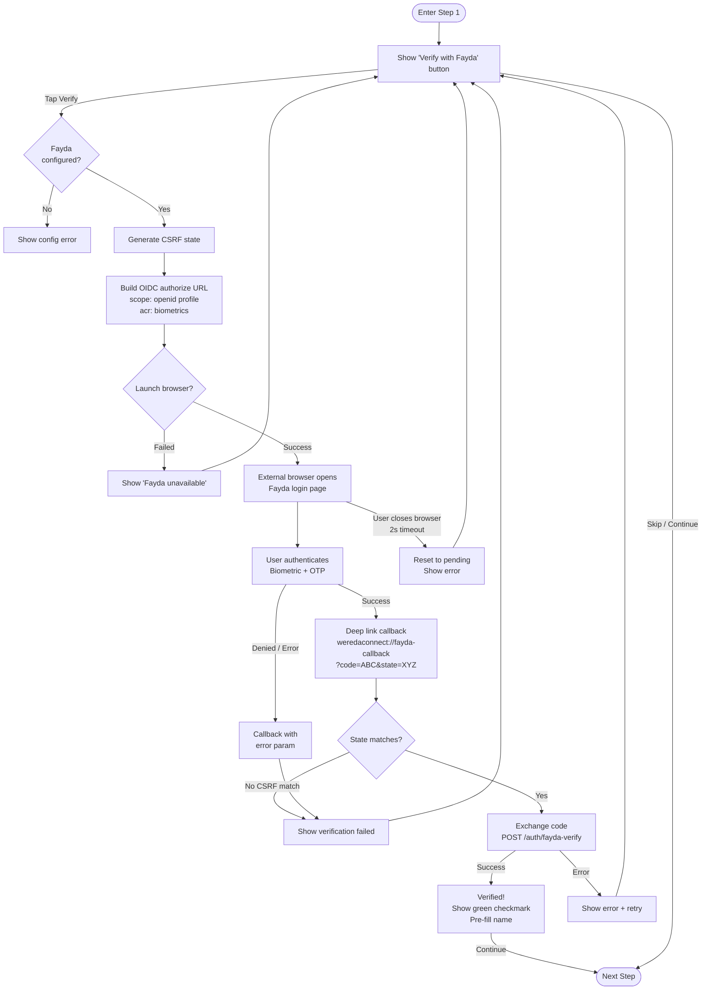
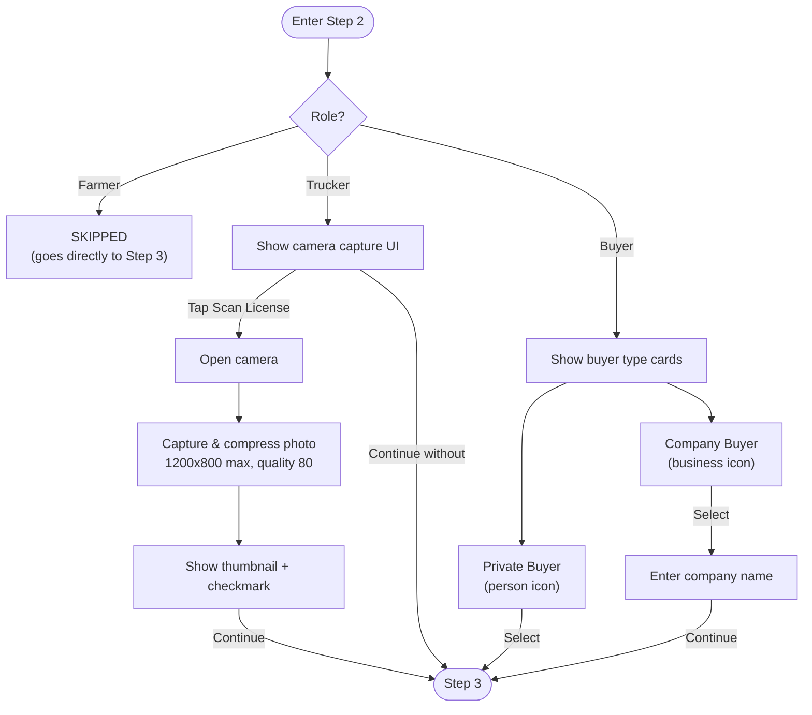
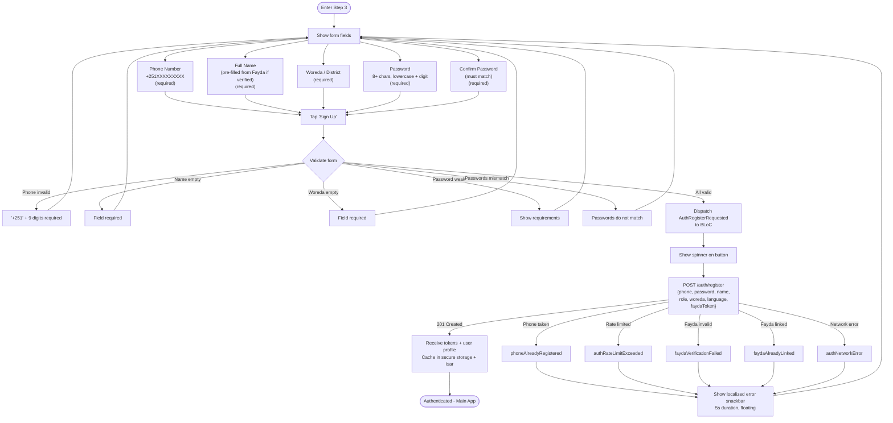
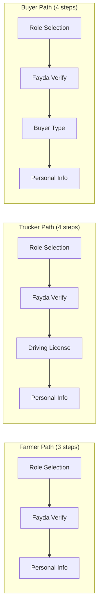

# Registration User Flow

## Overview

Multi-step registration flow with Fayda eKYC identity verification.
Farmers have 3 steps (skip role details), Truckers/Buyers have 4 steps.

## Main Flow

## Step 0: Role Selection

## Step 1: Fayda eKYC Verification (OIDC)

## Step 2: Role Details (Trucker / Buyer only)

## Step 3: Personal Info & Submit

## Complete Path Summary

