# VeriFayda 2.0 eKYC Integration Guide — WeredaConnect

> **Version**: 1.1.0
> **Date**: 2026-03-02
> **Status**: Design & Documentation (Validated)
> **Companion spec**: `verifayda-integration.md` (v0.2.0) — technical implementation plan

---

## Table of Contents

1. [Executive Summary](#1-executive-summary)
2. [What is VeriFayda 2.0](#2-what-is-verifayda-20)
3. [Why WeredaConnect Needs It](#3-why-weredaconnect-needs-it)
4. [Licensing & Production Requirements](#4-licensing--production-requirements)
5. [Development Architecture](#5-development-architecture)
6. [User Flows (Mermaid Diagrams)](#6-user-flows)
7. [Development Approach & Phasing](#7-development-approach--phasing)
8. [Offline-First eKYC Strategy](#8-offline-first-ekyc-strategy)
9. [Data Protection & Compliance](#9-data-protection--compliance)
10. [Risks & Mitigations](#10-risks--mitigations)
11. [Design Validation Notes](#11-design-validation-notes)
12. [References & Sources](#12-references--sources)

---

## 1. Executive Summary

WeredaConnect must integrate Ethiopia's **VeriFayda 2.0** eKYC system to meet the **National Bank of Ethiopia (NBE) mandate** requiring real identity verification for digital financial transactions above **10,000 ETB**. The harmonization deadline is **April 8, 2026**.

Currently, WeredaConnect collects Fayda ID numbers via manual text entry with no verification — a user can type any string. The integration will add real-time identity verification using the **Fayda eSignet OIDC** protocol, which authenticates users via **OTP** (or biometric) against Ethiopia's national identity database.

**Key decisions**:
- Use **OIDC Authorization Code Flow** via Fayda eSignet (not direct EthSwitch API)
- **Two-tier verification**: Standard (phone-verified, trade up to 10K ETB) + Verified (Fayda OIDC, unlimited)
- **Server-side token exchange** using `private_key_jwt` client authentication
- **Post-registration verification**: Fayda verification happens AFTER account creation, not during registration — avoids double-OTP confusion and reduces registration friction for rural users
- **No registration gate**: All phone-verified users can trade up to 10K ETB immediately. Fayda verification is a feature unlock, not a barrier to entry
- **QR offline fallback**: Fayda Encode scanning deferred to a research spike — format not publicly documented

### Design Decisions & Rationale

| Decision | Rationale |
|----------|-----------|
| Post-registration verification (not during registration) | Avoids double OTP (Fayda OTP + WeredaConnect SMS OTP) confusing low-literacy users; reduces registration drop-off; users can start trading immediately |
| Two tiers (not three) | ~65-75% of rural Ethiopians lack Fayda enrollment; blocking them from ALL trading would kill adoption. NBE mandate only applies to >10K ETB |
| OTP as default ACR | Rural users on $50 phones may lack cameras/fingerprint sensors; OTP only needs a phone that receives SMS |
| QR as research spike (not committed phase) | Fayda Encode QR format is undocumented; NIDP root key unavailable publicly; no existing parser to reference |
| Server-side token exchange | JWK private key stays on server (Secrets Manager); mobile app never touches secrets |

---

## 2. What is VeriFayda 2.0

### 2.1 Overview

**VeriFayda 2.0** is the second-generation electronic Know Your Customer (eKYC) and authentication platform for Ethiopia's national digital identity system, **Fayda**. It is the official mechanism through which organizations verify the identity of Ethiopian residents.

### 2.2 Key Actors

```
┌─────────────────────────────────────────────────────────────┐
│                    Ethiopian eKYC Ecosystem                   │
├──────────────┬──────────────────────────────────────────────┤
│ NIDP         │ National ID Program — operates Fayda,        │
│              │ manages partner registration, issues API      │
│              │ credentials, runs eSignet OIDC server         │
├──────────────┼──────────────────────────────────────────────┤
│ EthSwitch    │ National payment switch — operates VeriFayda │
│              │ 2.0 infrastructure, routes eKYC requests      │
│              │ between relying parties and Fayda backend     │
├──────────────┼──────────────────────────────────────────────┤
│ NBE          │ National Bank of Ethiopia — mandates eKYC    │
│              │ compliance, regulates financial institutions   │
├──────────────┼──────────────────────────────────────────────┤
│ INSA         │ Info Network Security Admin — cybersecurity   │
│              │ oversight, system security audit certification │
├──────────────┼──────────────────────────────────────────────┤
│ ECA          │ Ethiopian Communications Authority — data     │
│              │ protection regulator under Proclamation 1321   │
├──────────────┼──────────────────────────────────────────────┤
│ FISP         │ Fayda Infrastructure Service Provider —      │
│              │ gatekeeper for all KYC requests, creates      │
│              │ policies for their partners                    │
└──────────────┴──────────────────────────────────────────────┘
```

### 2.3 Technology Stack

| Component | Technology |
|-----------|-----------|
| Identity Platform | **MOSIP** (Modular Open Source Identity Platform), customized for Ethiopia |
| Authentication Server | **eSignet** — MOSIP's OpenID Connect-based auth server |
| Biometric Engine | **TECH5** T5-AirSnap (contactless capture) + T5-OmniMatch (liveness/matching) |
| Protocol | **OpenID Connect 1.0** over OAuth 2.0 |
| Offline Credential | **Fayda Encode** — digitally signed 2D barcode on physical ID card (format undocumented) |

### 2.4 Milestones & Scale

- **55+** public/private institutions already integrated
- **2 million+** bank accounts linked to Fayda IDs
- **70 million** enrollment target by 2027
- NBE mandated all banks use VeriFayda 2 for new accounts (Dec 1, 2025)
- All existing bank accounts must harmonize by **April 8, 2026**
- **Rural enrollment reality**: ~25-35% of rural Ethiopians have enrolled in Fayda (60%+ in Addis Ababa)

### 2.5 Identity Numbers

| Number | Description |
|--------|------------|
| **FIN** (Fayda Identification Number) | Primary 12-digit unique identifier |
| **FAN** (Fayda Alias Number) | Privacy-preserving alias, usable instead of FIN |
| **FCN** (Foundational Credential Number) | Credential reference number |

---

## 3. Why WeredaConnect Needs It

### 3.1 Regulatory Mandate

The NBE mandates VeriFayda 2.0 for:
- All **new bank account openings** (effective Dec 1, 2025)
- All **digital financial transactions > 10,000 ETB** (effective Jan 2026)
- All **existing accounts** must be harmonized by **April 8, 2026**

WeredaConnect uses **Telebirr escrow** for trade settlements. Without real eKYC, users cannot:
- Create escrow transactions above 10,000 ETB
- Access the full marketplace for high-value agricultural trades (cooperatives, wholesale)

**Important**: The NBE mandate does NOT require Fayda for transactions below 10,000 ETB. Most small farmer trades (600-2,000 ETB for 3-5 quintals) work fine without Fayda verification.

### 3.2 Current Gap

```
CURRENT STATE:
┌──────────────────────────────┐
│  User types "12345" as       │
│  Fayda ID → stored as string │ ← NO VERIFICATION
│  → passes escrow check       │
│  (only checks non-empty)     │
└──────────────────────────────┘

TARGET STATE:
┌──────────────────────────────┐
│  User authenticates via      │
│  Fayda OTP on eSignet        │ ← REAL VERIFICATION
│  → server verifies claims    │
│  → faydaVerified = true      │
└──────────────────────────────┘
```

### 3.3 Business Impact

| Metric | Without eKYC | With eKYC |
|--------|-------------|-----------|
| Max trade per transaction | 10,000 ETB | Unlimited |
| User trust level | Low (anyone can fake ID) | High (gov-verified) |
| NBE compliance for >10K ETB | Non-compliant | Compliant |
| Escrow eligibility | Capped | Full |
| Fraud risk for high-value trades | High | Low |
| Small farmer trading (<10K ETB) | **Works without Fayda** | **Works without Fayda** |

### 3.4 Target User Impact

| User Persona | Typical Trade | Needs Fayda? | Why |
|-------------|--------------|-------------|-----|
| Small farmer (3-5 quintals teff) | 600-2,000 ETB | No | Below 10K ETB threshold |
| Medium farmer (10-20 quintals) | 3,000-10,000 ETB | No | At or below threshold |
| Cooperative (50-200 quintals) | 50,000-200,000 ETB | **Yes** | Exceeds threshold |
| Urban wholesaler | 200,000+ ETB | **Yes** | Exceeds threshold |
| Trucker (transport fee) | 500-5,000 ETB | No | Below threshold |

---

## 4. Licensing & Production Requirements

### 4.1 Partner Registration Process

To integrate with VeriFayda 2.0, WeredaConnect must register as an **eKYC Partner** under the Fayda ecosystem. Here is the detailed process:

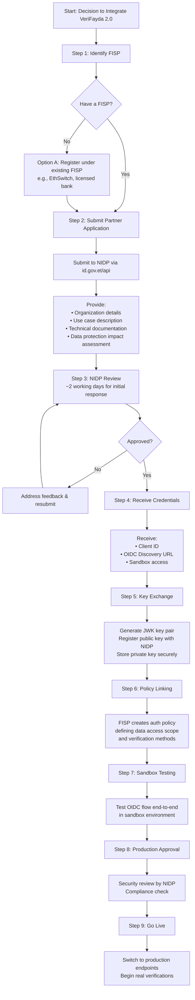

### 4.2 Detailed Licensing Steps

#### Step 1: Identify or Become a FISP

A **Fayda Infrastructure Service Provider (FISP)** acts as a gatekeeper for all KYC requests. WeredaConnect has two options:

| Option | Description | Recommended? |
|--------|------------|-------------|
| **Register under existing FISP** | Partner with EthSwitch, a licensed bank, or another registered FISP who will route your eKYC requests | **Yes** — faster, lower overhead |
| **Become a FISP** | Register directly with NIDP as an infrastructure provider | No — requires significant infrastructure and compliance investment |

**Recommendation**: Register under **EthSwitch** as the FISP, since WeredaConnect already uses EthSwitch infrastructure for Telebirr escrow payments.

#### Step 2: Submit Partner Application

Apply at **https://id.gov.et/api** with:

| Document | Description |
|----------|------------|
| **Organization Registration** | Ethiopian business license, TIN, trade registration |
| **Use Case Description** | "Agricultural logistics marketplace requiring identity verification for Telebirr escrow transactions per NBE mandate" |
| **Technical Architecture** | High-level system design showing how eKYC data flows |
| **Data Protection Impact Assessment** | How personal data is collected, stored, processed, and deleted per Proclamation 1321/2024 |
| **Partner API Key Request** | Request for `PartnerAPIKey` with specified `PartnerCode` and `UseCaseDescription` |

#### Step 3: NIDP Review

- **Initial response**: ~2 working days
- **Full approval**: Timeline varies (NIDP is actively onboarding partners due to April 2026 deadline)
- **Contact**: `support@id.et` for status updates

#### Step 4: Receive Credentials

Upon approval, NIDP provides:

```
FAYDA_OAUTH_CLIENT_ID          # Your registered client ID
FAYDA_AUTHORIZE_URL             # eSignet authorization endpoint
FAYDA_TOKEN_URL                 # eSignet token endpoint
FAYDA_USER_INFO_URL             # eSignet userinfo endpoint
FAYDA_JWKS_URL                  # JSON Web Key Set for token validation
```

#### Step 5: JWK Key Exchange

VeriFayda 2.0 uses `private_key_jwt` for client authentication (not client secrets):

```
1. Generate RSA or EC key pair (JWK format)
2. Register PUBLIC key with NIDP
3. Store PRIVATE key in AWS Secrets Manager
4. For each token request:
   a. Create JWT assertion signed with private key
   b. Set assertion type: urn:ietf:params:oauth:client-assertion-type:jwt-bearer
   c. Include in token exchange request
```

#### Step 6: Policy Linking

NIDP/FISP creates an **authentication policy** defining:
- Which demographic fields you can access (name, DOB, gender, address)
- Which verification methods are allowed (OTP, biometric, both)
- Transaction limits and data retention rules

#### Step 7: Sandbox Testing

Test the full OIDC flow in NIDP's sandbox environment before going live.

#### Step 8: Production Approval

Final review including:
- Security assessment of your integration
- Data handling compliance check
- Verification that you handle all error cases correctly

#### Step 9: Go Live

Switch endpoints from sandbox to production and begin real verifications.

### 4.3 Additional Regulatory Requirements

#### If WeredaConnect is Classified as a Payment Instrument Issuer

If WeredaConnect's escrow functionality classifies it as a payment instrument issuer under **Directive ONPS/10/2025**, additional requirements apply:

| Requirement | Details |
|------------|---------|
| **Minimum paid-up capital** | ETB 100 million (~$800K-900K USD) |
| **Security audit** | Every 6 months by INSA, results submitted to NBE |
| **Two-factor authentication** | Required for all financial transactions (PIN, OTP, or biometric) |
| **Interoperability** | Must integrate with EthSwitch for wallet-to-wallet transfers |
| **Data localization** | All customer data must be stored within Ethiopia |
| **Professional staff** | Technical leadership with CISSP, CISM, or CEH certifications |

**Note**: WeredaConnect may not need this classification if it only facilitates Telebirr-to-Telebirr escrow without being a payment instrument issuer. Legal counsel should confirm.

### 4.4 Data Residency Requirements

Under **Proclamation 1321/2024** and NBE directives:

| Requirement | Impact on WeredaConnect |
|------------|------------------------|
| Customer data must be stored within Ethiopia | Need Ethiopian hosting for identity data, or use AWS Local Zones/Partner |
| Cross-border transfer restricted | Cannot send eKYC data to servers outside Ethiopia without stringent conditions |
| Primary AND backup data in Ethiopia | Redundancy must also be local |

**Options for WeredaConnect** (currently on AWS):

1. **AWS Outposts / Local Zones** — if available in Ethiopia (check availability)
2. **Ethio Telecom hosting** — government-affiliated data center
3. **Raxio Ethiopia** — Tier III certified data center
4. **Hybrid approach** — identity data in Ethiopian DC, non-PII on AWS (recommended)

**ACTION REQUIRED (Phase 0)**: Obtain legal opinion on whether Proclamation 1321/2024 applies to a marketplace facilitating Telebirr escrow vs. a bank/payment instrument issuer. This determines whether Ethiopian DC hosting is mandatory or optional. The legal opinion must be obtained BEFORE Phase 2 (sandbox integration), as it affects infrastructure architecture.

### 4.5 Cost Structure

API pricing is provided during partner onboarding. Specific pricing is **TBD — pending NIDP onboarding**.

For budgeting purposes, comparable systems suggest:

| Cost Type | Rough Estimate (unconfirmed) |
|-----------|------------------------------|
| Per eKYC verification (OTP) | ~1-5 ETB per transaction |
| Per eKYC verification (biometric) | ~3-10 ETB per transaction |
| Annual partner license | Negotiable (volume-based) |
| Infrastructure (Ethiopian DC) | ~$200-500/month for basic setup |

**ACTION REQUIRED (Phase 0)**: Contact NIDP at `support@id.et` to get confirmed pricing before committing to production timeline.

---

## 5. Development Architecture

### 5.1 High-Level System Architecture

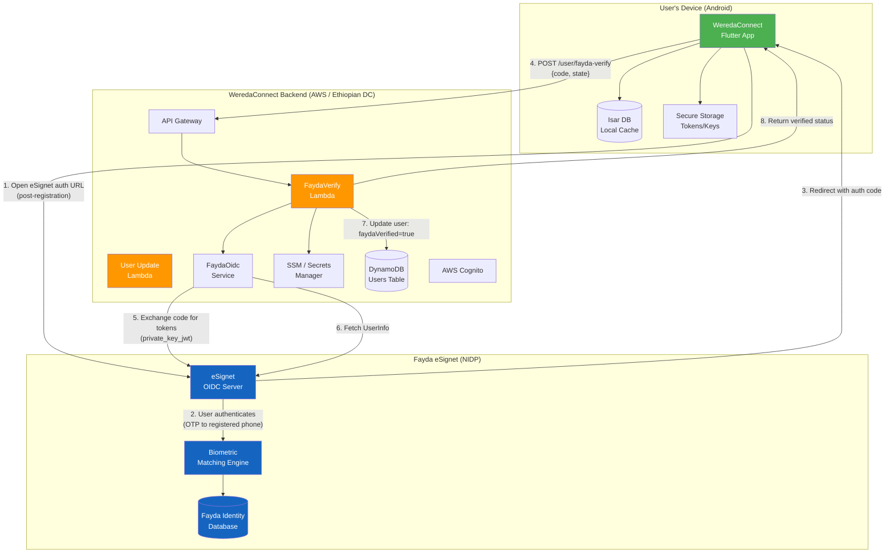

**Key change from v1.0.0**: Fayda verification is now a **post-registration** operation. The user already has an account and auth tokens. The `/user/fayda-verify` endpoint is authenticated (requires Bearer token), not public.

### 5.2 Server-Side Component Architecture

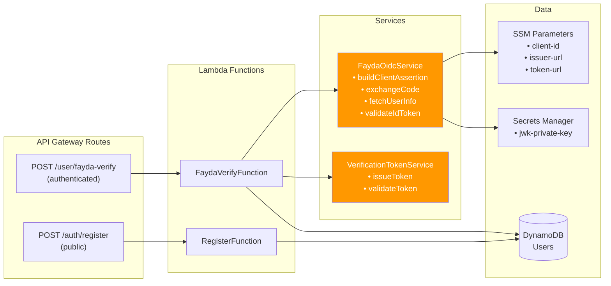

**Removed from v1.0.0**: `FaydaQrVerifyFunction` and `FaydaQrService` — QR verification is deferred to a research spike.

### 5.3 Mobile Component Architecture

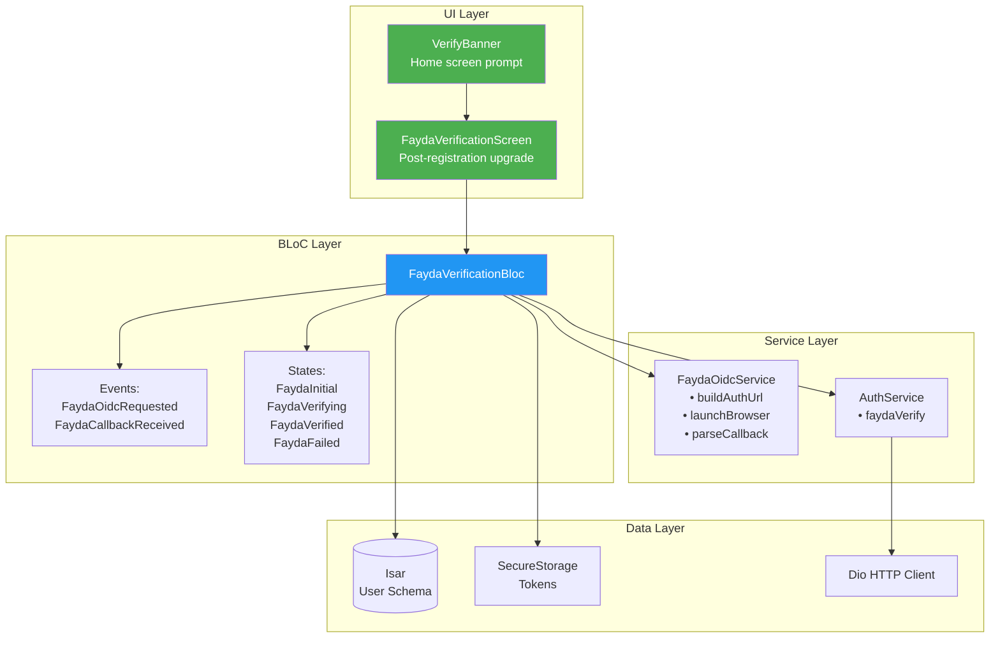

**Changes from v1.0.0**:
- Separate `FaydaVerificationBloc` instead of overloading `AuthBloc`
- `VerifyBanner` widget on home screen replaces registration Step 2
- QR scanner screen removed (deferred to research spike)

### 5.4 OIDC Token Exchange Sequence (Post-Registration)

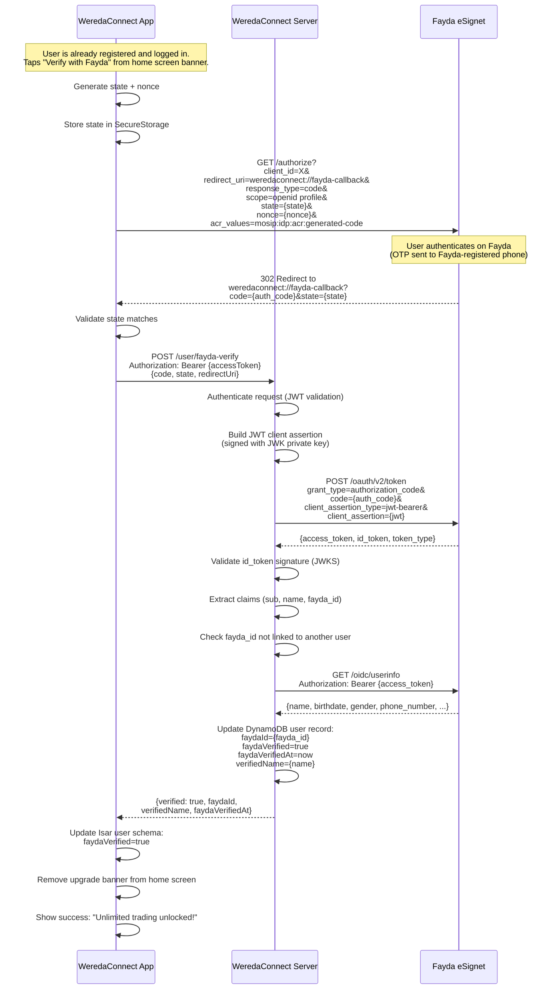

**Changes from v1.0.0**:
- Removed PKCE (unnecessary — server does token exchange via `private_key_jwt`, not the mobile app)
- Flow is post-registration (user already has Bearer token)
- Server directly updates DynamoDB instead of issuing a separate verification token
- No intermediate verification token needed — the user is already authenticated

### 5.5 Authentication Methods (ACR Values)

The eSignet server supports multiple Authentication Context Reference (ACR) values:

| ACR Value | Method | Best For |
|-----------|--------|----------|
| `mosip:idp:acr:generated-code` | OTP sent to registered phone | **Rural users** — only needs a phone, no camera required |
| `mosip:idp:acr:biometrics` | Face/fingerprint match | Users with biometric-capable devices |
| `mosip:idp:acr:linked-wallet` | Fayda Wallet binding | Users with Fayda Wallet installed |
| `mosip:idp:acr:password` | Password-based | Fallback |

**WeredaConnect recommendation**: Default to `mosip:idp:acr:generated-code` (OTP) for broadest rural accessibility, with optional biometric for users who prefer it.

### 5.6 API Endpoints (WeredaConnect Server)

#### POST /user/fayda-verify (New — Authenticated)

Exchange a Fayda eSignet authorization code for verified identity claims. Requires a valid Bearer access token (user must be registered and logged in).

**Request**:
```json
{
  "authorizationCode": "abc123...",
  "state": "random-state-value",
  "redirectUri": "weredaconnect://fayda-callback"
}
```

**Response (200)**:
```json
{
  "verified": true,
  "faydaId": "123456789012",
  "verifiedName": "Abebe Kebede",
  "faydaVerifiedAt": "2026-03-02T12:00:00Z"
}
```

**Error Codes**:

| Status | Code | Description |
|--------|------|-------------|
| 400 | `FAYDA_001` | Invalid or expired authorization code |
| 400 | `FAYDA_002` | State mismatch (CSRF protection) |
| 502 | `FAYDA_003` | Fayda service unavailable |
| 422 | `FAYDA_004` | Fayda ID already linked to another account |
| 401 | `AUTH_001` | Missing or invalid access token |
| 500 | `AUTH_007` | Internal server error |

#### Unchanged: POST /auth/register

Registration no longer involves Fayda verification. The existing endpoint stays as-is — `faydaId` remains an optional field for manual entry (stored unverified, used for display only).

```json
{
  "phoneNumber": "+251912345678",
  "password": "securePass1",
  "displayName": "Abebe Kebede",
  "role": "farmer",
  "woreda": "Bishoftu",
  "preferredLanguage": "am",
  "faydaId": "123456789012"
}
```

The `faydaVerified` flag is ONLY set to `true` by the `/user/fayda-verify` endpoint after successful OIDC verification. Manual entry of `faydaId` during registration does NOT set `faydaVerified`.

---

## 6. User Flows

### 6.1 Registration Flow (Unchanged — No Fayda Gate)

Registration remains as-is. Fayda verification is no longer part of registration.

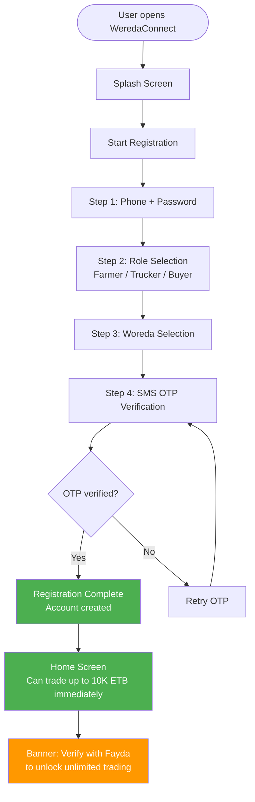

**Why Fayda is NOT in registration**:
- Avoids double OTP confusion (Fayda OTP + WeredaConnect SMS OTP in one session)
- Reduces registration drop-off for low-literacy users
- Users can trade immediately after phone verification (most trades are <10K ETB)
- Fayda verification can happen later when convenient and connectivity is good

### 6.2 Post-Registration Fayda Verification (Primary Verification Flow)

This is the main verification flow, accessible from the home screen banner or profile settings:

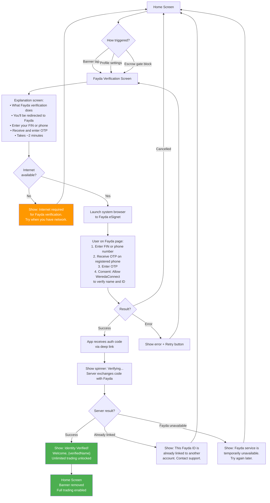

### 6.3 Fayda OIDC Detailed Flow (Browser Redirect)

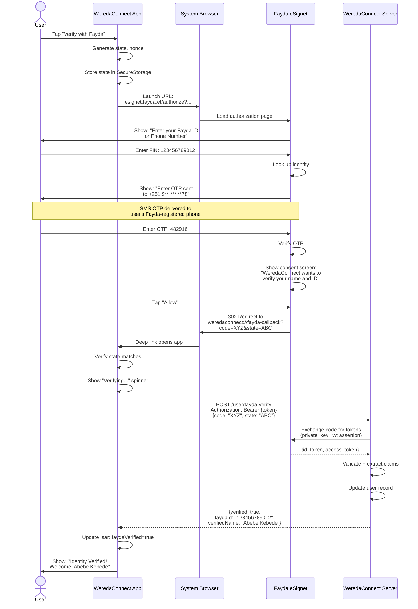

### 6.4 Escrow Transaction Verification Gate

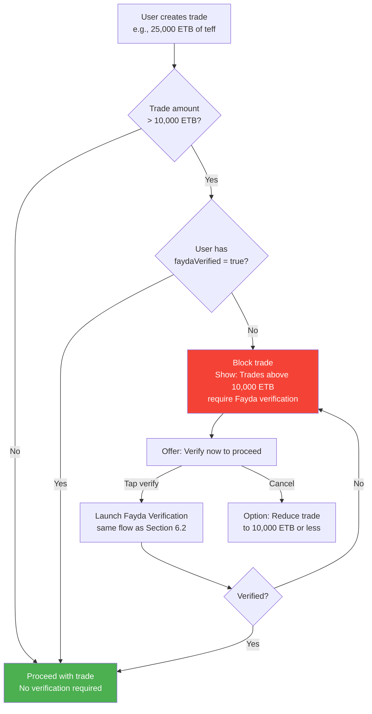

### 6.5 Two-Tier Verification Model

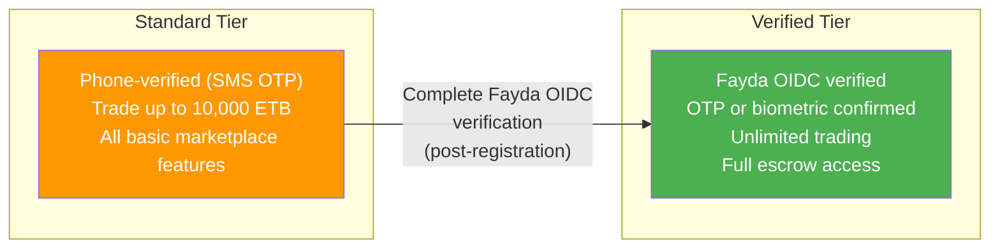

**Key principle**: No user is ever blocked from basic trading. Every phone-verified user can trade immediately. Fayda verification is a **feature unlock** for high-value trades, not a barrier to entry.

**Why two tiers instead of three**:
- ~65-75% of rural target users lack Fayda enrollment
- Most farmer trades are 600-2,000 ETB (well below 10K threshold)
- A "browse only" tier would kill adoption before users experience value
- NBE mandate only applies to >10K ETB transactions

---

## 7. Development Approach & Phasing

### 7.1 Development Phases

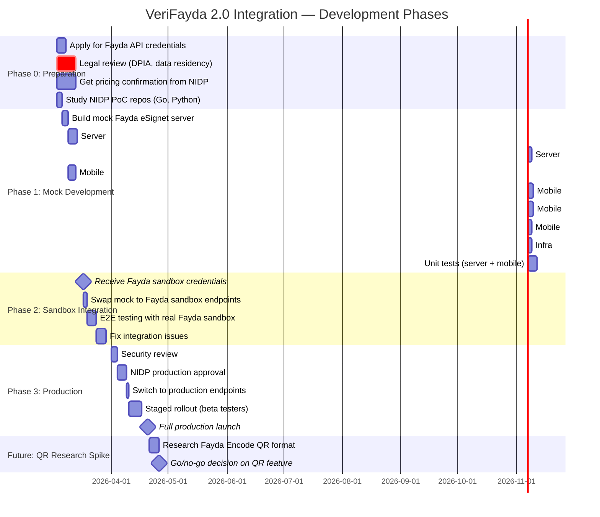

**Changes from v1.0.0**:
- QR offline fallback moved from committed Phase 3 to **future research spike** with go/no-go gate
- Legal review marked as **critical path** — data residency decision blocks Phase 2
- Pricing confirmation added to Phase 0
- Phase numbering simplified (3 committed phases + future research)

### 7.2 Phase 0: Preparation (Days 1-10)

**Goal**: Get all prerequisites in motion before writing code.

| Task | Owner | Details | Blocking? |
|------|-------|---------|-----------|
| Apply for Fayda API access | Product/Legal | Submit at https://id.gov.et/api with business docs | Yes — blocks Phase 2 |
| Contact NIDP support | Product | Email `support@id.et` explaining use case | Yes |
| Legal review: DPIA | Legal | Data Protection Impact Assessment per Proclamation 1321/2024 | Yes — blocks production |
| Legal review: data residency | Legal | Does Proclamation 1321 require Ethiopian DC for a marketplace? | **Critical** — blocks architecture |
| Legal review: payment issuer | Legal | Is WeredaConnect a payment instrument issuer under ONPS/10/2025? | Blocks business model |
| Get pricing confirmation | Product | Confirm eKYC API pricing with NIDP | Blocks budgeting |
| Study NIDP PoC repos | Developer | Clone `fayda-auth-go`, `fayda-auth-python`, understand OIDC params | No |
| Study eSignet docs | Developer | Read `docs.esignet.io` for OpenAPI spec and configuration | No |

**Key references to study**:
- https://github.com/National-ID-Program-Ethiopia/fayda-auth-go
- https://github.com/National-ID-Program-Ethiopia/fayda-auth-python
- https://github.com/National-ID-Program-Ethiopia/oidc-test-app
- https://github.com/mosip/esignet (eSignet OpenAPI spec)
- https://docs.esignet.io (eSignet documentation)
- https://nidp.atlassian.net/wiki/spaces/FAPIQ (Fayda API specification)

### 7.3 Phase 1: Mock Development (Days 3-20)

**Goal**: Build the full integration against a mock Fayda server so development isn't blocked by API access.

#### Mock Fayda eSignet Server

Create a lightweight mock server that implements the essential OIDC endpoints:

```
mock-fayda-server/
├── server.js (or server.py)
├── .well-known/
│   ├── openid-configuration.json
│   └── jwks.json
├── authorize          # Returns auth page, redirects with code
├── oauth/v2/token     # Exchanges code for tokens
└── oidc/userinfo      # Returns mock user claims
```

The mock should:
- Return predictable test users (e.g., FIN `111111111111` → "Test Farmer")
- Simulate errors (expired code, duplicate FIN, service unavailable)
- Use the same JWT structure as real eSignet
- Support `private_key_jwt` client authentication

#### Server Development

1. **FaydaOidcService** (`server/src/Services/FaydaOidcService.cs`)
   - AOT-safe using `System.Net.Http` + `System.Text.Json` source gen
   - `private_key_jwt` client assertion builder
   - Token exchange and UserInfo fetch
   - ID token signature validation via JWKS

2. **FaydaVerifyFunction** (`server/src/Functions/FaydaVerifyFunction.cs`)
   - New Lambda for `POST /user/fayda-verify` (authenticated endpoint)
   - Validates Bearer token, exchanges Fayda code, updates user record
   - Rate limited: 10 verifications per user per day

3. **Modified UserDto** — add `FaydaVerified`, `FaydaVerifiedAt`, `VerifiedName` fields
4. **Modified EscrowService** — check `FaydaVerified` boolean, not `FaydaId` string

#### Mobile Development

1. **FaydaOidcService** (`lib/core/auth/fayda_oidc_service.dart`)
   - Build authorization URL with correct params (state, nonce, ACR)
   - Launch system browser via `url_launcher`
   - Parse deep link callback
   - Send code to server with auth token

2. **FaydaVerificationScreen** — standalone screen for post-registration verification
3. **VerifyBanner widget** — persistent prompt on home screen for unverified users
4. **FaydaVerificationBloc** — separate from AuthBloc to avoid overloading
5. **Deep link config** — AndroidManifest intent filter for `weredaconnect://fayda-callback`
6. **Localization** — all new strings in English, Amharic, Afan Oromo

### 7.4 Phase 2: Sandbox Integration (Days 15-28)

**Goal**: Replace mock endpoints with real Fayda sandbox.

**Pre-condition**: Data residency legal opinion from Phase 0 must be resolved.

| Task | Details |
|------|---------|
| Configure sandbox endpoints | Update SSM parameters with real URLs |
| Generate production JWK pair | Create RSA key pair, register public key with NIDP |
| E2E testing | Test with real Ethiopian phone numbers in sandbox |
| Error handling | Handle all real-world error cases from Fayda |
| Performance testing | Verify OIDC flow completes in <10s on 3G |

### 7.5 Phase 3: Production (Days 28-42)

**Goal**: Security review, NIDP approval, and staged rollout.

| Task | Details |
|------|---------|
| Security review | Internal review of data handling, token storage, error cases |
| NIDP production approval | Submit for final review, address feedback |
| Staged rollout | Release to beta testers in target woredas |
| Monitor | Track verification success rates, error rates, latency |
| Full launch | Release to all users |

### 7.6 Future: QR Offline Research Spike

**Status**: Deferred. Not committed to any timeline.

**Goal**: Determine feasibility of Fayda Encode QR scanning for offline verification.

**Open questions (must be answered before committing)**:

| Question | Status |
|----------|--------|
| Is the Fayda Encode QR payload format publicly documented? | Unknown |
| Can NIDP provide the root public key for local signature verification? | Unknown |
| Do all Fayda cards include QR codes, or only newer versions? | Unknown |
| Can $50 phones with low-res cameras reliably scan the QR? | Untested |
| Does Fayda Encode contain enough demographic data for eKYC? | Unknown |

**Go/no-go criteria**:
- If all 5 questions answered positively → proceed to implementation
- If any question answered negatively → abandon QR approach, rely on OIDC + manual fallback

**If QR proceeds**, the local verification would sync via the normal sync engine (no new server endpoint needed — just set `faydaVerified=true` locally and sync the user profile update).

### 7.7 Files to Create / Modify

#### New Files

| File | Description |
|------|------------|
| `server/src/Functions/FaydaVerifyFunction.cs` | Lambda: POST /user/fayda-verify (authenticated) |
| `server/src/Services/FaydaOidcService.cs` | OIDC token exchange + claim extraction |
| `server/src/Models/FaydaDtos.cs` | Request/response DTOs with JsonSerializerContext |
| `mobile/lib/core/auth/fayda_oidc_service.dart` | OIDC authorization flow handler |
| `mobile/lib/features/verification/bloc/fayda_verification_bloc.dart` | Separate BLoC for Fayda flow |
| `mobile/lib/features/verification/screens/fayda_verification_screen.dart` | Post-registration verification UI |
| `mobile/lib/features/verification/widgets/verify_banner.dart` | Home screen upgrade prompt |

#### Modified Files

| File | Changes |
|------|---------|
| `server/src/Models/UserDto.cs` | Add FaydaVerified, FaydaVerifiedAt, VerifiedName |
| `server/src/Services/EscrowService.cs` | Check FaydaVerified boolean (not FaydaId string) |
| `server/src/AppJsonContext.cs` | Add new DTOs to source gen |
| `mobile/lib/core/database/schemas/user.dart` | Add faydaVerified, faydaVerifiedAt |
| `mobile/lib/features/home/screens/home_screen.dart` | Add VerifyBanner widget |
| `android/app/src/main/AndroidManifest.xml` | Deep link intent filter |
| `mobile/pubspec.yaml` | Add url_launcher |
| `mobile/lib/shared/l10n/app_en.arb` | New l10n keys |
| `mobile/lib/shared/l10n/app_am.arb` | Amharic translations |
| `mobile/lib/shared/l10n/app_om.arb` | Afan Oromo translations |
| `infra/lib/api-stack.ts` | SSM params, Secrets Manager, API route, Lambda |

**Removed from v1.0.0**: `fayda_qr_service.dart`, `FaydaQrVerifyFunction.cs`, `mobile_scanner` package dependency. Registration flow files (`fayida_id_screen.dart`, `registration_flow.dart`, `auth_event.dart`) are no longer modified for this feature.

---

## 8. Offline-First eKYC Strategy

### 8.1 Core Principle

Fayda OIDC verification **requires internet** — this is inherent to the OIDC protocol. However, the **result** of verification is cached offline, and no user is ever blocked from basic functionality due to lack of verification.

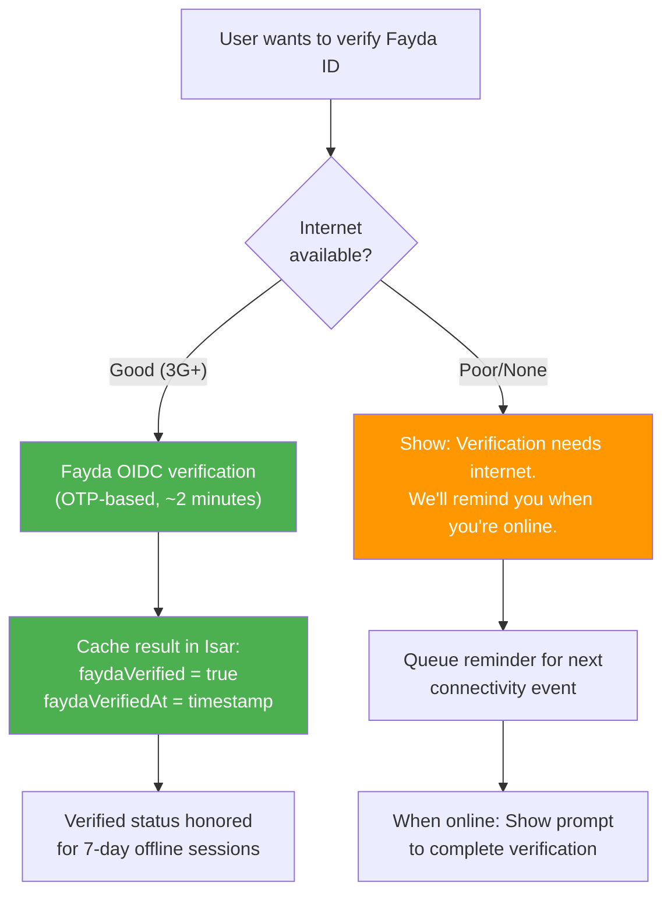

### 8.2 Cached Verification Rules

| Rule | Value |
|------|-------|
| **Cache duration** | Indefinite (verification is point-in-time) |
| **Re-verification prompt** | After 12 months, show "Refresh your verification" |
| **Offline session** | Cached `faydaVerified` flag honored for up to 7 days offline |
| **Sync on reconnect** | Server is source of truth; client syncs verification status |
| **Conflict resolution** | Server wins (if server says unverified, client must comply) |

### 8.3 What Works Offline Without Verification

| Feature | Offline? | Needs Fayda? |
|---------|----------|-------------|
| Browse crop listings | Yes | No |
| Create crop listing | Yes (queued) | No |
| Browse trip listings | Yes | No |
| Create trip listing | Yes (queued) | No |
| Trade up to 10K ETB | Yes (queued) | No |
| Trade above 10K ETB | Yes (queued) | **Yes — checked at escrow creation on server** |
| View own profile | Yes | No |
| Fayda verification itself | **No — requires internet** | N/A |

### 8.4 Future: Fayda Encode QR — Offline Verification (Research Spike)

The **Fayda Encode** is a digitally signed 2D barcode printed on the physical Fayda ID card. It reportedly contains:

- Fayda Identification Number (FIN)
- Holder's name
- Date of birth, Gender
- Issuer information
- Digital signature (NIDP root key)

**This is NOT a committed feature.** The following must be confirmed before development:

1. QR payload format documentation must be obtained from NIDP
2. NIDP root public key must be obtainable for local verification
3. Camera quality on $50 phones must be tested for QR scanning reliability
4. Fayda cards with QR codes must be prevalent among target users

**Limitations even if implemented**:
- Cannot verify that the person holding the card is the card owner (no biometric)
- Card could be lost/stolen
- QR format may change with new Fayda card versions
- Lower trust level than OIDC (no real-time authentication)

---

## 9. Data Protection & Compliance

### 9.1 Personal Data Protection Proclamation No. 1321/2024

WeredaConnect must comply with Ethiopia's data protection law:

| Principle | WeredaConnect Implementation |
|-----------|----------------------------|
| **Lawful basis** | User consent during verification (Fayda consent screen + in-app consent) |
| **Purpose limitation** | eKYC data used only for identity verification and escrow eligibility |
| **Data minimization** | Request only `openid` + `profile` scopes; don't request unnecessary fields |
| **Storage limitation** | Store only: FIN, verified name, verification timestamp. No biometrics stored. |
| **Data subject rights** | Users can request data export/deletion via in-app settings |
| **Cross-border transfer** | Pending legal opinion on whether Ethiopian DC is required (see Section 4.4) |
| **Security** | All PII encrypted at rest (Isar encryption, DynamoDB encryption, Secrets Manager for keys) |

### 9.2 Data Handling Summary

```
WHAT WE STORE:
  faydaId (FIN) — for escrow verification
  faydaVerified (boolean) — for tier determination
  faydaVerifiedAt (timestamp) — for audit trail
  verifiedName (from Fayda) — for display/matching

WHAT WE NEVER STORE:
  Biometric data (fingerprint, face) — processed by Fayda only
  Authorization codes — used once, discarded
  Fayda access/ID tokens — discarded after claim extraction
  Full demographic data — only name is stored
  Fayda ID card images — obsoleted by OIDC verification
```

### 9.3 Data Protection Impact Assessment (DPIA) Checklist

Before going to production, complete this DPIA:

- [ ] Document all personal data processing activities related to eKYC
- [ ] Identify lawful basis for each processing activity
- [ ] Assess necessity and proportionality of data collection
- [ ] Identify and assess risks to data subjects
- [ ] Determine measures to mitigate identified risks
- [ ] Consult with ECA (Ethiopian Communications Authority) if required
- [ ] Document data retention and deletion policies
- [ ] Establish breach notification procedures (72-hour requirement)
- [ ] Appoint Data Protection Officer if required by Proclamation 1321
- [ ] Register as a data controller/processor with ECA

---

## 10. Risks & Mitigations

| # | Risk | Probability | Impact | Mitigation |
|---|------|------------|--------|------------|
| 1 | **Fayda API not available** for third-party startups yet | Medium | High | Develop against mock; standard-tier trading works without Fayda |
| 2 | **Licensing delays** beyond April 2026 deadline | Medium | High | Apply immediately (Phase 0); escalate via EthSwitch relationship |
| 3 | **Data residency** requires Ethiopian DC | High | Medium | Legal opinion in Phase 0; hybrid approach if required |
| 4 | **Rural users lack Fayda enrollment** (~65-75%) | High | **Low** (mitigated) | Two-tier model — all users trade up to 10K ETB without Fayda; show enrollment center locations for those who want to upgrade |
| 5 | **Low-end phones can't run WebView** for OIDC | Medium | Medium | Uses system browser (not WebView); manual entry as permanent fallback; test on $50 devices early |
| 6 | **Fayda service downtime** | Medium | Low | Cached verification; trades <10K ETB unaffected; retry prompt when service returns |
| 7 | **Pioneer territory** — no agritech has done this | Medium | Low | Thorough testing; budget time for API quirks |
| 8 | **Cost per verification** unknown | Medium | Medium | Get pricing confirmation in Phase 0 before committing |
| 9 | **JWK key compromise** | Low | Critical | Store in Secrets Manager; rotate keys quarterly; key per environment |
| 10 | **ETB 100M capital requirement** if classified as payment issuer | Medium | Critical | Legal opinion on whether escrow facilitation = payment instrument; may need to partner with licensed entity |
| 11 | **Same phone number for Fayda OTP and WeredaConnect** | High | **Low** (mitigated) | Post-registration flow eliminates double-OTP problem — Fayda OTP happens separately from registration SMS OTP |

---

## 11. Design Validation Notes

This section documents the design review conducted on 2026-03-02 and the changes applied in v1.1.0.

### Issues Found & Resolved

| # | Issue | Severity | Resolution |
|---|-------|----------|-----------|
| 1 | Three-tier model blocked 65-75% of target users from ANY trading | Critical | Simplified to two tiers: Standard (phone-verified, trade <10K) + Verified (Fayda OIDC, unlimited) |
| 2 | Double OTP during registration (Fayda OTP + WeredaConnect SMS) confused low-literacy users | Critical | Moved Fayda verification to post-registration flow, separating the two OTPs entirely |
| 3 | QR offline fallback was speculative (undocumented format, unavailable root key) | High | Downgraded from committed Phase 3 to research spike with go/no-go gate |
| 4 | PKCE mentioned alongside `private_key_jwt` added confusion | High | Removed PKCE from flow — server authenticates via JWT assertion, PKCE unnecessary |
| 5 | Verification token expiry between registration steps was unspecified | Medium | Eliminated by removing Fayda from registration — post-registration flow has no token gap |
| 6 | Data residency decision was deferred without action | Medium | Added as critical-path Phase 0 deliverable with legal opinion requirement |
| 7 | Cost estimates were unverifiable | Low | Marked as TBD, added pricing confirmation to Phase 0 |
| 8 | `POST /auth/fayda-qr-verify` endpoint contradicted "offline" claim | High | Removed endpoint entirely — if QR proceeds, verification syncs via normal sync engine |

### Design Fitness Assessment

| Dimension | Fit | Notes |
|-----------|-----|-------|
| **Offline-first** | Good | Verification requires internet but result is cached; no feature is gated on verification below 10K ETB |
| **Low-literacy users** | Good | Post-registration avoids double OTP; OTP-only ACR avoids biometric confusion; simple upgrade banner |
| **$50 phones (2GB RAM)** | Good | System browser (not WebView); no heavy packages; no camera required for OIDC path |
| **3G connectivity** | Good | OIDC flow is lightweight (~3-5KB); verification is one-time, not per-transaction |
| **Solo developer sustainability** | Good | Two verification paths (OIDC + manual) instead of three; separate BLoC avoids AuthBloc complexity explosion |
| **Ethiopian regulatory compliance** | Pending | Legal opinion needed on data residency and payment issuer classification |
| **AOT compliance** | Good | All proposed server libraries on allowed list |
| **Cultural appropriateness** | Good | l10n in all 3 languages; terminology familiar to rural users |

---

## 12. References & Sources

### Official Resources

| Resource | URL |
|----------|-----|
| Fayda National ID Portal | https://id.gov.et/ |
| Fayda API Application | https://id.gov.et/api |
| Fayda Authentication Info | https://id.gov.et/authentication |
| NIDP Confluence (API Spec) | https://nidp.atlassian.net/wiki/spaces/FAPIQ/pages/633733136 |
| NIDP Support Email | support@id.et |

### GitHub Repositories

| Repository | Description |
|-----------|------------|
| [fayda-auth-go](https://github.com/National-ID-Program-Ethiopia/fayda-auth-go) | Official Go PoC for Fayda eSignet OIDC |
| [fayda-auth-python](https://github.com/National-ID-Program-Ethiopia/fayda-auth-python) | Official Python PoC for Fayda eSignet OIDC |
| [oidc-test-app](https://github.com/National-ID-Program-Ethiopia/oidc-test-app) | NIDP OIDC test application |
| [fayda-python-sdk](https://pypi.org/project/fayda-python-sdk/) | Python SDK for Fayda IDA services |
| [fayda-auth-sdk](https://github.com/kalebalebachew/fayda-auth-sdk) | Community Node.js SDK for Fayda OIDC |
| [mosip/esignet](https://github.com/mosip/esignet) | MOSIP eSignet source code + OpenAPI spec |

### Documentation

| Resource | URL |
|----------|-----|
| eSignet Documentation | https://docs.esignet.io |
| eSignet OpenID Configuration | https://docs.esignet.io/esignet-authentication/develop/configuration/.well-known/openid-configuration |
| eSignet ACR Configuration | https://docs.esignet.io/esignet-authentication/develop/configuration/acr |
| MOSIP Documentation | https://docs.mosip.io/1.2.0/integrations/e-signet |

### Regulatory

| Resource | URL |
|----------|-----|
| Data Protection Proclamation 1321/2024 | https://www.metaappz.com/References/ethiopian_laws/federal/pr_1321_2024/en/txt |
| NBE Payment Instrument Directive ONPS/10/2025 | https://nbe.gov.et/files/onps-10-2025-oversight-of-the-natioanl-payment-system-licensing-and-authorization-of-payment-instrument-issuer-amendment-directive/ |
| Ethiopia Data Protection Analysis (CIPIT) | https://cipit.org/ethiopias-personal-data-protection-proclamation-of-2024-and-its-budding-digital-identity-regime/ |
| Fintech Licensing Guide (Kiya Law) | https://kiyalaw.com/legal-update8.html |

### News & Context

| Resource | URL |
|----------|-----|
| NBE Mandates VeriFayda 2 for Banking | https://birrmetrics.com/nbe-rolls-out-verifayda-2-as-mandatory-onboarding-for-new-accounts/ |
| Fayda Linked Accounts Pass 2 Million | https://shega.co/news/fayda-linked-accounts-pass-2-million-as-ethiopian-banks-escalate-efforts-ahead-of-april-deadline |
| 55 Institutions Integrated | https://idtechwire.com/ethiopias-digital-id-system-now-integrated-across-55-key-institutions/ |
| Fayda Wallet Launch (TECH5) | https://tech5.ai/ethiopia-launches-fayda-wallet/ |
| Ethiopia PKI Launch | https://idtechwire.com/ethiopia-launches-national-public-key-infrastructure/ |
| NIDP-MOSIP Partnership Extension | https://www.mosip.io/news_events/ethiopia-s-national-id-program-nidp-extends-their-partnership-with-mosip |
| Fayda ID Wikipedia | https://en.wikipedia.org/wiki/Fayda_ID |

---

**Last Updated**: 2026-03-02
**Author**: WeredaConnect Engineering
**Version**: 1.1.0 (validated)
**Status**: Design & Documentation — awaiting Fayda API credentials and legal review
